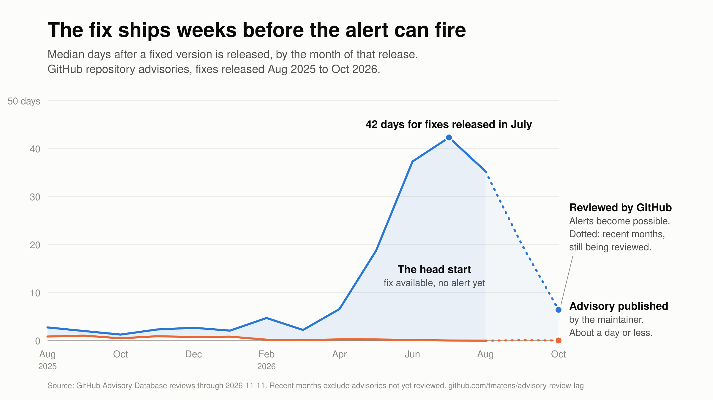

# advisory-review-lag

Measures how long a security fix in an open source package takes to reach the
GitHub Advisory Database, which is the source for Dependabot alerts and for
language-package findings in scanners that read the reviewed advisory set.

The write-up is [The fix ships weeks before your scanner knows](https://tmatens.github.io/advisory-review-lag/),
also [on dev.to](https://dev.to/tmatens/the-fix-ships-weeks-before-your-scanner-knows-2g35).

## Findings

From the snapshot of 14,173 advisories reviewed between 2025-08-22 and
2026-11-11 (full tables in `data/report.md`):

- Maintainers published the advisory within about a day of releasing the fix,
  at the median, throughout the period.
- The wait from release to GitHub's review went from 1 to 5 days (fixes
  released through March 2026) to 37 to 42 days (fixes released June and July
  2026).
- With a seven-day hold-back before updating, the fix was still in place before
  the review for 70% to 86% of fixes released May to August 2026.
- Severity made no measurable difference to the wait. The CVE record was not
  an earlier signal for most advisories.
- At least 842 advisories in reviewed ecosystems had a CVE and no review at
  collection time (`data/unreviewed.md`).

Recent months undercount, because advisories not yet reviewed are missing.
See Limits.

## What it records

For each advisory reviewed in a date window it records four public timestamps:

| Timestamp | Meaning | Source |
|---|---|---|
| `release` | The first patched version was published to its registry | deps.dev, Packagist |
| `repo_published` | The maintainer published the repository advisory | GitHub repository advisory API |
| `cve_published` | The CVE record was published | CVE Services API |
| `reviewed` | GitHub reviewed the advisory into the Advisory Database | GitHub global advisory API |

## Usage

    python3 collect.py --since 2025-08-22
    python3 analyze.py > data/report.md
    python3 chart.py
    python3 curl_cna.py > data/curl-cna.md
    python3 assigner.py > data/cna.md
    python3 kev_check.py > data/kev.md
    python3 unreviewed.py > data/unreviewed.md
    python3 downloads.py > data/downloads.md
    python3 repo_meta.py
    python3 explore.py > docs/EXPLORATORY.md

Python 3.11 or later, standard library only. `collect.py` reads a GitHub token
from `GITHUB_TOKEN`, or from `gh auth token` if that is unset. The token needs
no permissions, because everything read here is public. Each stage caches under
`data/cache/`, so an interrupted run resumes where it stopped. Before a long
wait for GitHub quota it writes the partial dataset and `data/midrun-report.md`.

Working notes, prior work and open questions are in `docs/NOTES.md`. Exploratory cuts kept for
reference (severity, stars, repository age, queue depth and others) are in
`docs/EXPLORATORY.md`, each with its caveat. `data/repo_meta.jsonl` holds the
repository metadata they use.

## Method

The approach follows Segal, Segal and Menasché, "Characterizing and Modeling
the GitHub Security Advisories Review Pipeline" (MSR 2026, arXiv:2602.06009),
whose data ends on 2025-08-21. The default window here starts the next day.

- The global advisory record's `published_at` is the review date for advisories
  that came from a repository advisory. The maintainer's own publication date
  is read from the linked repository advisory.
- The API cannot filter on review date. The collector lists advisories by
  modification date and filters on `github_reviewed_at`.
- An advisory's release date is the earliest registry publish time among its
  first patched versions.

## Limits

- **Reviewed advisories only.** An advisory that is published in a repository
  but not yet reviewed, or never reviewed, is not in the data. Waiting times
  here are for advisories that were eventually reviewed. `unreviewed.py` gives a
  lower bound on how many are missing: 842 in-scope advisories with a CVE in
  the 2026-11-11 snapshot.
- **Review is prioritised.** GitHub states that repository advisories are
  prioritised by project impact and severity, so these figures do not describe
  a first-come queue.
- **Disclosure dates need a repository advisory.** Advisories that reached the
  database another way have no maintainer publication date.
- **Release dates are incomplete.** Some advisories have no patched version,
  and some registries are not covered.
- **A release is not the first time a fix is public.** The fixing commit is
  usually visible earlier.
- **Fields can be edited after review.** A patched version changed later can
  produce a release date after the disclosure date.

## Licence

The code is under the MIT licence (`LICENSE`). The dataset and reports under
`data/` are under Creative Commons Attribution 4.0 (`LICENSE-DATA`): reuse them
freely, with credit and a link to this repository.
