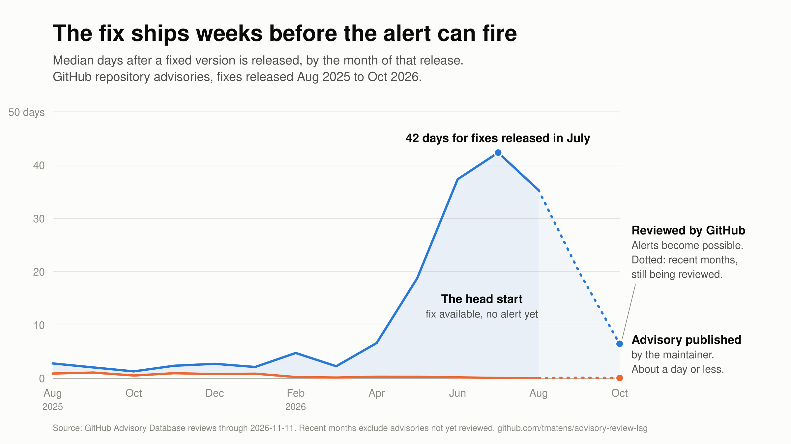

# The fix ships weeks before your scanner knows

*What 14,173 GitHub-reviewed advisories say about how long a fix waits to be noticed*

*By Todd Matens, November 12, 2026. compose-lint is a personal project and is not affiliated with my employer. The views here are my own.*

On September 27 I published a release of [compose-lint](https://tmatens.github.io/compose-lint/), a security linter for Docker Compose files that I maintain. It fixed [two vulnerabilities](https://github.com/tmatens/compose-lint/security/advisories), and I published the advisories about fifteen minutes later. GitHub reviewed them 44 days after that, and until then no scanner that relies on GitHub's advisory data could tell anyone running an affected version that a fix existed. I wanted to know how typical that was, so I pulled the data.

If you run a vulnerability management program, the clock for a finding starts when your scanner reports it, and a scanner can only report what's in the vulnerability data it reads. That's true for any kind of software. I measured the gap for open source packages, where the dates are public, using one of the main sources, the GitHub Advisory Database. For fixes released this summer, the typical advisory was reviewed into it about four weeks after the fixed version was published, and six weeks in the worst month.

*Median days after the fixed version was released. The orange line is when the maintainer published the advisory. The blue line is when GitHub reviewed it, which is the earliest a scanner reading that data could report it. The shaded months are too recent to read. Advisories that haven't been reviewed yet aren't counted, so these numbers will likely rise.*

That's probably not a surprise to those of us who have been watching CVE volume this year. GitHub has [written about the backlog](https://github.blog/security/supply-chain-security/inside-the-advisory-database-and-what-happens-when-vulnerability-volume-breaks-records) themselves, and in April [NIST said](https://therecord.media/nist-to-limit-work-on-cve-entries-surge) it would stop fully analyzing most CVEs in the National Vulnerability Database (NVD) because submissions were outrunning it.

What's easy to miss in the tsunami of published vulnerabilities is that there's a good chance your exposure time has gone up if you rely on your scanner as the trigger. So the question I wanted to answer was how much of that time you can skip by updating when the release ships and not when the finding shows up.

## What I measured

I used GitHub's public API to collect every advisory reviewed into the Advisory Database between August 22, 2025 and November 11, 2026. That came to 14,173 advisories, and 10,873 of them started as a repository advisory published by the project's maintainer. For each one I recorded when the fixed version reached its registry, when the maintainer published the advisory, when the CVE was published, and when GitHub reviewed it. The start date picks up where [an earlier study of the same pipeline](https://arxiv.org/abs/2602.06009v1) leaves off, and my first six months matched its results.

## What I found

These are median days from the fixed version being released to GitHub's review, grouped by the month of the release. It's too early to read September and October, because advisories that haven't been reviewed yet aren't counted.

| Fix released in | Median days to GitHub's review |
|---|---|
| Aug 2025 to Mar 2026 | 1 to 5 |
| Apr 2026 | 7 |
| May 2026 | 19 |
| Jun 2026 | 37 |
| Jul 2026 | 42 |
| Aug 2026 | 35 |
| Sep 2026 (too early to tell) | 20 |
| Oct 2026 (too early to tell) | 7 |

Maintainers aren't where the time went. The [usual guidance for open source projects](https://oss-vulnerability-guide.openssf.org/maintainer-guide.html) is to release the fix and publish the advisory together, and most did. At the median they published within a day of shipping the fix for the whole period, which is the flat orange line in the chart. The change is all in the review. Reviews of repository advisories went from a few hundred a month to 1,377 in March, and GitHub was still turning most of them around in a few days. The wait starts to show for fixes released in April and May, and it was at its worst for June and July.

## When it mattered

Most of these advisories aren't known to be exploited, and I don't want to overstate the risk. I checked the data against CISA's Known Exploited Vulnerabilities list and found 25 matches among about 12,000 advisories that have a CVE. Two of them stood out. The Gitea maintainers published a critical advisory on July 28. CISA added it to the list on August 25, and GitHub reviewed it on September 8. The GPUStack maintainers published a critical advisory on July 31, and it was reviewed on November 9, which is 101 days later and the same day CISA listed it. In both cases the fixed version had been available the whole time.

Severity is also becoming a weaker guide to what can be exploited. The UK's National Cyber Security Centre [said in 2025](https://www.ncsc.gov.uk/report/impact-ai-cyber-threat-now-2027) that the time between disclosure and exploitation "has shrunk to days and AI will almost certainly reduce this further". This April the UK government's AI Security Institute [reported](https://www.aisi.gov.uk/blog/our-evaluation-of-claude-mythos-previews-cyber-capabilities) that one of the newest models could "discover and exploit vulnerabilities autonomously", though its tests had no active defenders. The model's developer, Anthropic, [describes](https://www.anthropic.com/research/mythos-preview) it chaining two to four vulnerabilities into a working exploit, including bugs that weren't much use on their own. So I'd be careful about treating a low severity fix as one that can wait.

## What doesn't shorten the wait

Two things you might expect to get you the fix sooner don't.

One is watching for the CVE. For fixes released this summer, the CVE was published a median of 33 days after the fix, which is no sooner than GitHub's review. A CVE also doesn't make a scanner see the fix on its own. One of my advisories had a published CVE that GitHub hadn't reviewed yet, and when I scanned an affected version with Trivy, it didn't report it.

The other is counting on severity. A critical waited about as long as a low, close to three weeks at the median, and 41% of the criticals waited more than a month. GitHub says they prioritize by impact and severity, and that may decide which advisories get reviewed at all. I can only see the ones that were.

## What helps

Through all of this, the fixed version was available the whole time. What helps is anything that gets it installed without waiting for a finding.

Updating when the release ships does that, and both of the common tools can already do it. Dependabot has [version updates](https://docs.github.com/en/code-security/dependabot/dependabot-version-updates/about-dependabot-version-updates), which GitHub describes as pull requests that keep dependencies updated "even when they don't have any vulnerabilities", and Renovate does the same by default. Neither waits for an advisory. What waits is the other half of each tool: Dependabot's alerts, which [only fire for advisories GitHub has reviewed](https://docs.github.com/en/code-security/dependabot/dependabot-alerts/about-dependabot-alerts), the security updates those alerts trigger, and Renovate's security pull requests. If a repository only has security alerts turned on, it only has the half that waits.

The pushback I'd expect is that taking new releases right away is how you end up installing a malicious one, or one that breaks something. Both are fair concerns, and waiting a few days helps with both. I've seen plenty of projects ship something broken and follow it with a fix within days, and the compromised releases that made the news this year were pulled faster than that. The malicious Trivy release in March was [available for about three hours](https://www.aquasec.com/blog/trivy-supply-chain-attack-what-you-need-to-know/), and the LiteLLM versions on PyPI for [a few hours](https://www.kaspersky.com/blog/critical-supply-chain-attack-trivy-litellm-checkmarx-teampcp/55510/).

Those are the well-known cases, though. A malicious package nobody is watching can sit for much longer. Testing helps with what gets past the wait, and scanning and vetting the artifacts themselves matters too, but that's a topic for a different article.

A lot of teams hold new versions back for a few days for these reasons, and I do the same. How many days to wait is a decision. It should be a deliberate one, automated in most cases, and it shouldn't wait for a vulnerability to be reported. So I checked how much of the head start is left for a few choices. The table shows the share of advisories where the fix had already been out longer than the hold-back by the time GitHub reviewed it.

| Fix released in | 3 days | 7 days | 14 days |
|---|---|---|---|
| Aug 2025 to Mar 2026 | 36% to 60% | 22% to 46% | 16% to 36% |
| May 2026 | 91% | 70% | 56% |
| Jun 2026 | 87% | 78% | 70% |
| Jul 2026 | 90% | 84% | 70% |
| Aug 2026 | 92% | 86% | 80% |
| Sep 2026 (too early to tell) | 99% | 95% | 70% |

So if you had waited a full week before merging any update, you would still have had the fix before your scanner could report it for 70% to 86% of the fixes released from May through August. This held for widely used libraries too. For npm and PyPI packages with more than 10 million downloads a month, which is 200 packages including urllib3, cryptography, undici and ws, fixes waited a median of about 22 days for review, and 79% had been out for more than a week by then.

## What a program can do

There's more than one way to respond to this, and I don't think there's a single right answer.

- Make automated updates the easy default. Give teams a setup that works out of the box and expect them to use it, so most fixes land before there's a finding. It doesn't need a policy change, but it does need tooling and tests that teams trust.
- Start the clock when the fix is available instead of when the scanner reports it. This is the most direct, and the hardest. It touches audit evidence and tooling, and it's a lot to ask of a team that can't see the fix either.
- Add earlier signals to your scanning, such as project or vendor advisories, where your tools support them. I'd check that they're actually earlier before relying on them.

I'm not recommending one of these over the others. The first is the one I've done on my own project.

## What it looks like for maintainers

I asked Daniel Stenberg, who maintains curl, if this is different for a project that is its own CVE Numbering Authority (CNA) and issues its own CVEs. He told me in a public exchange on LinkedIn: "we are a CNA, we get them the same second we ask for them: zero friction". The data backs that up. CVEs from projects that run their own CNA were published within a day or two of the fix this summer, and the ones GitHub assigned took a median of 41 days. I'm considering going through the CNA process myself, more as an academic exercise than because compose-lint needs it.

## What this doesn't tell you

- Every advisory in the tables was reviewed eventually, so the real wait is longer than what I'm showing. GitHub has issued CVEs since May for at least 842 advisories in ecosystems it reviews that still weren't in the database when I collected the data, and half of those had been waiting more than 135 days.
- It's too early to read the last two months. Eleven days after June ended it looked the way October does now, about 7 days, and it finished at 37. March looked low at the same stage and stayed low, so the drop at the end of the chart could be a recovery or June again.
- Updating on release assumes the fix is in a version you can move to. If it only lands in a new major version, or it's several levels down in your dependency tree, it takes more than a version bump.
- Where an advisory lists more than one fixed version, I counted from the earliest. Most were published within a day of each other, and counting from the latest changes the summer median by less than a day.
- This only covers the package ecosystems GitHub reviews. It doesn't say anything about operating system packages.

None of this needs a new tool. The fixed version was there the whole time, and both of the common update bots will propose it without waiting for an advisory. How a program makes use of that is its own call. For my part, the next time I ship a fix, I won't expect anyone's scanner to notice for a while, and I'd rather their update bot got there first.

The scripts, the data, the full report and the rest of the caveats are at [github.com/tmatens/advisory-review-lag](https://github.com/tmatens/advisory-review-lag) if you want to check my work or run it yourself.
